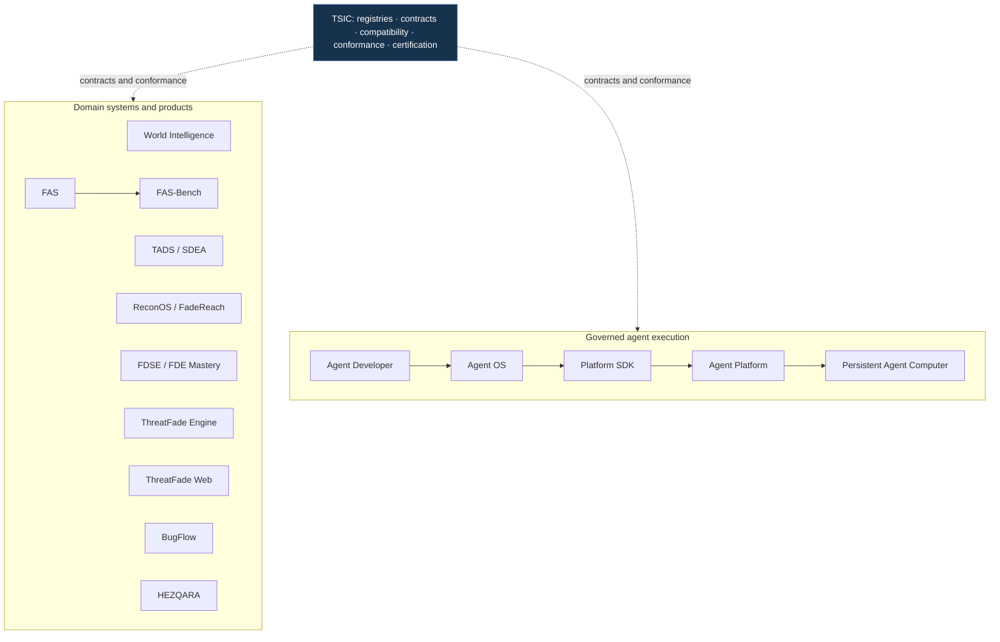

# Tinlance System Integration & Conformance (TSIC)

**The integration control plane for engineering teams that define, validate, and certify interoperability across the Tinlance system-of-systems.**

TSIC owns canonical system registries, integration contracts, compatibility policy, conformance tooling, and certification evidence. It does not replace domain runtimes, authorization services, agent execution, or application logic.

<p align="center">
  <a href="https://github.com/LloydCoder/tinlance-system-integration/actions/workflows/ci.yml"></a>
  <a href="https://github.com/LloydCoder/tinlance-system-integration/actions/workflows/codeql.yml"></a>
  <a href="LICENSE"></a>
</p>

## Architecture at a glance



The diagram is a conceptual boundary map, not a deployment topology or a claim that every integration is live in production.

## Why TSIC

| Concern | TSIC's responsibility | Explicitly not TSIC's responsibility |
|---|---|---|
| System identity | Canonical system registry and identifiers | Owning each system's runtime |
| Authority | Capability ownership and conflict detection | Granting execution permissions |
| Integration | Versioned contracts, adapters, and event semantics | Implementing domain business logic |
| Compatibility | Change policy and compatibility evidence | Silently accepting breaking changes |
| Conformance | Deterministic validators and acceptance gates | Treating a green workflow as production certification |
| Certification | Evidence lineage and phase records | Claiming live deployment without deployment evidence |

## Quick Start

Prerequisites: Git and Python 3.

```bash
git clone https://github.com/LloydCoder/tinlance-system-integration.git
cd tinlance-system-integration
python3 scripts/certify_phase0.py
python3 tooling/validate_phase0.py
python3 tooling/run_reference_workflow.py
```

The commands above run the repository's authority-lock, structural conformance, and reference-workflow checks. They do not deploy services or certify production environments.

## Installation

TSIC is a governance, contract, and conformance repository; it is not currently distributed as an installable Python package.

| Use case | Setup |
|---|---|
| Core JSON and structural checks | Python 3; no third-party packages required by the listed scripts |
| CloudEvents JSON Schema validation | Install the pinned CI dependency with `python3 -m pip install -r requirements-ci.txt` |
| GitHub Actions | Run automatically for pull requests to `main` and configured pushes |
| Windows | Use `py` in place of `python3` and the platform's virtual-environment paths |

Recommended isolated setup for schema-dependent checks:

```bash
python3 -m venv .venv
. .venv/bin/activate
python -m pip install -r requirements-ci.txt
python scripts/validate_event_contract.py
```

PowerShell activation: `.venv\Scripts\Activate.ps1`. The CI workflow uses Ubuntu runners; local results can differ if Python or operating-system versions differ.

## Usage

### Run the canonical phase and repository checks

```bash
python3 scripts/certify_phase0.py
python3 tooling/validate_phase0.py
python3 tooling/forensic_audit.py
python3 tooling/security_scan.py
```

### Validate a cross-repository integration contract

```bash
python3 scripts/validate_twi_integration.py
```

### Validate the CloudEvents envelope and delivery semantics

After installing `requirements-ci.txt`:

```bash
python3 scripts/validate_event_contract.py
```

### Run the reference and recovery checks

```bash
python3 tooling/run_reference_workflow.py
python3 tooling/recovery_cert.py
```

The authoritative list of CI gates is [.github/workflows/ci.yml](.github/workflows/ci.yml). Run the relevant script directly for focused feedback; use CI as the merge gate.

## Configuration and normative sources

TSIC is configured through version-controlled manifests, registries, contracts, and policies. There is no required runtime `.env` file.

| Path | Purpose | Authority |
|---|---|---|
| `manifests/ecosystem.json` | Registered systems and declared governance roles | Normative registry |
| `catalog/capabilities/authority.json` | Capability ownership | Normative registry |
| `catalog/dependencies/graph.json` | Directed system dependency graph | Normative registry |
| `catalog/phases/registry.json` | Canonical TSIC-00 through TSIC-19 sequence | Normative registry |
| `catalog/contracts/registry.json` | Contract identifiers and versions | Normative registry |
| `catalog/services/registry.json` | Service identifiers and protocols | Normative registry |
| `policies/ecosystem-lock.json` | Ecosystem invariants and deny-oriented policy | Normative policy |
| `workflows/canonical.json` | Canonical integration workflow definitions | Normative registry |
| `conformance/requirements/` | Phase acceptance requirements | Normative requirements |
| `catalog/phases/evidence-ledger.json` | Historical reviewed-baseline evidence | Evidence record; not production proof |

Change normative artifacts deliberately. Update their schemas, validators, compatibility notes, and documentation in the same pull request where applicable.

## Features

| Capability | Description |
|---|---|
| Ecosystem registry | Stable system identifiers, repositories, and governance roles |
| Authority model | Explicit ownership and single-authority invariants |
| Contract registry | Versioned interface and event contract references |
| Adapter governance | Declared integration edges and adapter rules |
| Compatibility policy | Change impact and migration expectations |
| Conformance tooling | Deterministic Python and JSON validation |
| Recovery certification | Failure, retry, replay, and recovery checks |
| Security baseline | Secret-pattern checks and policy validation |
| Evidence ledger | Exact-commit workflow evidence with production-claim boundaries |
| Interoperability | MCP/A2A contract and authority boundary documentation |

## Programme governance

The cross-repository completion baseline is maintained in the [Tinlance Agent Systems — Final Completion Programme](docs/programmes/FINAL-COMPLETION-PROGRAMME.md). It crosswalks the Platform M0–M29 roadmap, ecosystem P0–P10 matrix, TSIC-00…TSIC-19 certification sequence and persistent-computer W2–W6 acceptance without conflating their numbering or completion criteria.

## Canonical architecture and phase sequence

The master ecosystem sequence is **TSIC-00 through TSIC-19**, defined by [catalog/phases/registry.json](catalog/phases/registry.json). The registry is the machine-readable source of truth.

Key authority boundaries:

- **Agent Platform** is the sole generic consequential execution authority.
- **Agent OS** owns workspace, environment, lifecycle, and orchestration above the Platform.
- **Agent Platform SDK** is a developer client surface; it does not grant authority.
- **TSIC** owns ecosystem contracts, registries, compatibility, conformance, and certification evidence. It does not execute domain work.
- **FAS** is production evidence-analysis authority; **FAS-Bench** is independent evaluation authority and must not become a FAS runtime dependency.
- Domain systems retain authority within their declared domains.
- **Persistent Agent Computer** is a governed runtime substrate beneath Agent Platform, not a second authorization authority.

The previous TSIC-31–41 numbering is retained as historical evidence only. See [the historical numbering note](docs/architecture/serial-integration-31-41.md).

## Documentation

| Type | Start here |
|---|---|
| Tutorial | [Repository quick start](docs/README.md#tutorials) |
| How-to | [Operations and integration guides](docs/README.md#how-to-guides) |
| Explanation | [Architecture overview](docs/architecture/overview.md) |
| Reference | [Documentation index](docs/README.md) |
| Governance | [GOVERNANCE.md](GOVERNANCE.md) |
| Security | [SECURITY.md](SECURITY.md) |
| Contribution | [CONTRIBUTING.md](CONTRIBUTING.md) |
| Machine-readable index | [llms.txt](llms.txt) |

## Contributing

Contributions are welcome when they preserve explicit authority boundaries and improve contracts, compatibility, conformance, security, or documentation. Start with [CONTRIBUTING.md](CONTRIBUTING.md), open an issue for material design changes, and submit a pull request with validation evidence.

## License and acknowledgements

TSIC is licensed under the [Apache License 2.0](LICENSE). The project uses open standards and specifications where applicable, including JSON Schema, CloudEvents, OpenAPI, AsyncAPI, MCP, A2A, and the W3C PROV family. Their inclusion does not imply certification or endorsement by their maintainers.

## Roadmap

- Keep TSIC-00..19 as the sole canonical ecosystem phase sequence.
- Reconcile historical evidence without rewriting immutable baseline claims.
- Improve deterministic contract, security, and recovery verification.
- Publish releases with traceable source revisions and provenance.
- Improve contributor onboarding and documentation coverage.

## Troubleshooting

| Symptom | First check |
|---|---|
| Authority-lock assertion fails | Compare `manifests/ecosystem.json`, `catalog/capabilities/authority.json`, and `policies/ecosystem-lock.json` |
| Phase sequence fails | Check `catalog/phases/registry.json` for exactly TSIC-00..19 and serial entry conditions |
| JSON validation fails | Inspect the reported file and validate against its referenced schema |
| Schema-dependent script cannot import `jsonschema` | Install `requirements-ci.txt` in the active Python environment |
| CI differs from local | Compare Python version, runner, dependencies, and exact commit SHA |

## Support

Use GitHub Issues for reproducible defects and scoped proposals. Do not report vulnerabilities or share secrets in public issues; follow [SECURITY.md](SECURITY.md).
