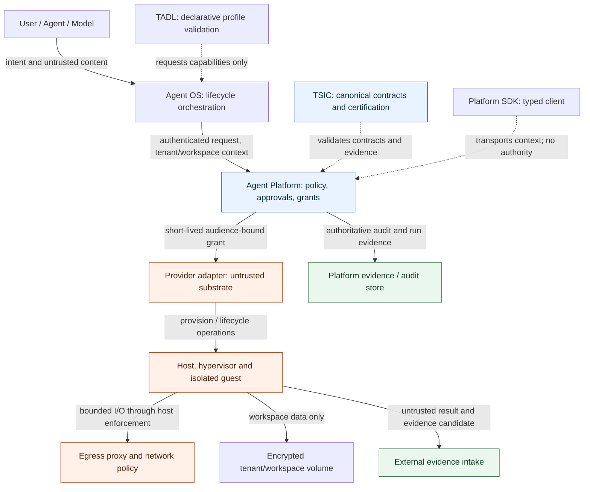

# Persistent Agent Computer — Threat Model

**Status:** Phase 1 design baseline; Phase 2 implementation and evidence in progress  
**Updated:** 2026-11-07  
**Scope:** Multi-tenant persistent agent computers, browser/terminal execution, workspace storage, provider control plane and recovery.

## 1. Security objectives

1. Prevent cross-tenant access to compute, memory, files, browser sessions, network, secrets and evidence.
2. Ensure only Agent Platform can authorize consequential execution.
3. Prevent guest compromise from becoming host or control-plane compromise.
4. Prevent prompt injection and untrusted tool/browser content from changing policy or authority.
5. Preserve integrity and causal lineage of runs, grants, operations and evidence.
6. Ensure revocation, cancellation, expiry and tenant suspension reach running computers.
7. Prevent replay, duplicate provisioning, split-brain leases and duplicate side effects after recovery.
8. Bound resource consumption and financial exposure.
9. Ensure snapshots and backups cannot resurrect stale authority or secrets.
10. Support forensic investigation without relying on guest-controlled logs.

## 2. Assets and trust boundaries

### Assets
- Platform signing keys, grant issuer, policy and approval state.
- Tenant, subject, agent, workspace, run and capability identities.
- Provider credentials, hypervisor API sockets, host kernel/KVM and host metadata.
- Guest kernel, memory, image, filesystem, browser profile, cookies and downloads.
- Workspace volumes, VM snapshots, backups, artifact objects and encryption keys.
- Egress policy, DNS resolver, proxy identity and network routes.
- Lifecycle operation journal, leases, fencing tokens, idempotency records.
- Audit events, evidence references, trace context, logs and telemetry.
- User approvals, connector tokens and secret material.

### Trust boundaries
- B1: user/agent/model ↔ OS orchestration.
- B2: OS ↔ Platform API/SDK.
- B3: Platform control plane ↔ provider adapter.
- B4: provider host/hypervisor ↔ guest microVM/container.
- B5: guest ↔ workspace volume/object store.
- B6: guest/browser ↔ egress proxy and external internet.
- B7: guest output ↔ evidence/audit service.
- B8: snapshot/backup store ↔ restore controller.
- B9: agent ↔ peer agent/MCP/A2A connector.

Only B2's authenticated Platform request and B3's Platform-issued grant can authorize an execution. B4-B9 are untrusted data and execution boundaries.

## 2.1 Trust-boundary diagram

The provider adapter and guest are untrusted. Only Platform-issued grants authorize execution; guest output is evidence input, never authoritative audit. TSIC certifies contracts and does not provision or execute workloads.

## 3. Threat actors and assumptions

- Malicious tenant with valid account attempting cross-tenant escape or resource abuse.
- Compromised or prompt-injected agent attempting unauthorized actions.
- Malicious website, document, browser extension, package, repository or downloaded artifact.
- Compromised guest process attempting host escape or metadata/credential theft.
- Malicious or compromised provider worker/operator.
- Stale or compromised OS worker replaying operations or grants.
- Supply-chain attacker compromising base image, hypervisor binary, browser or extension.
- External attacker exploiting public control-plane or egress-facing services.

Assumptions: cloud/provider host and hardware have residual trust; no sandbox is an absolute guarantee. Host OS, hypervisor, firmware, KVM, control plane and identity services require patching, monitoring and incident response. Side-channel and hardware attacks remain residual risks.

## 4. Threat scenarios and required controls

| ID | Threat | Impact | Required preventive controls | Detection/recovery evidence |
|---|---|---|---|---|
| PC-01 | Guest escapes container or sandbox into host | Host compromise, cross-tenant data exposure | Per-instance microVM for hostile tier; jailed VMM; seccomp; namespaces; cgroups; no privileged mounts/devices | Host integrity telemetry, canary tests, isolate host, preserve forensic image |
| PC-02 | Guest reaches another tenant's disk or browser profile | Confidentiality and integrity breach | Dedicated volume/key/profile per tenant-workspace; no shared writable mounts; access checks outside guest | Cross-tenant negative tests, storage audit, revoke tenant leases |
| PC-03 | Guest accesses cloud metadata/provider credentials | Provider account takeover | Block metadata IPs at host egress; no host creds in guest; scoped workload identity; proxy deny rules | Egress alerts, credential rotation, host quarantine |
| PC-04 | DNS rebinding, redirect or IPv6 bypass reaches private/control-plane network | SSRF, lateral movement | Resolve and validate each connection; pin policy at connect; revalidate redirects; block RFC1918, loopback, link-local, ULA, metadata and control-plane routes | Egress policy logs, adversarial SSRF suite, route revocation |
| PC-05 | Prompt injection in page/document/tool output requests privileged action | Unauthorized side effect | Treat retrieved content as data; capability allowlist; Platform reauthorization; approval gates; content/action separation | Tool decision trace, policy denial and approval evidence |
| PC-06 | Forged/replayed execution grant | Unauthorized execution | Audience-bound signed grant, short expiry, unique nonce, run/capability/tenant binding, one-time consumption and revocation | Replay tests, grant ledger, deny and alert |
| PC-07 | OS worker or guest bypasses Platform and directly executes host action | Authority bypass | Provider adapter accepts only Platform grant; no direct provider API from OS/TADL/SDK; CI architecture invariants | Negative integration tests, trace correlation |
| PC-08 | Snapshot resurrects expired secret, approval, token or stale idempotency state | Stale authority, duplicate side effect | No secrets in snapshots; restore quarantine; rotate credentials; reconcile policy, approvals, leases and idempotency; one successor per snapshot | Restore-after-revocation tests, secret scans, grant ledger |
| PC-09 | Snapshot cloned twice reuses app-level randomness or identity | Duplicate identity, cryptographic misuse | Single-successor restore; generation/fencing; guest re-key protocol; dedupe app identifiers; no blind clone fan-out | Concurrent restore race tests, uniqueness checks |
| PC-10 | Compromised image/browser/extension | Guest compromise or supply-chain execution | Signed images, provenance/SBOM, pinned digests, vulnerability scanning, allowlisted extensions, promotion and rollback | Image attestation, scan reports, incident rollback |
| PC-11 | Malicious download/archive exhausts disk or parser | RCE, decompression bomb, resource exhaustion | Quarantine downloads; MIME/type validation; archive limits; malware scan; CPU/memory/disk quotas | Download audit, bomb tests, quota events |
| PC-12 | Queue redelivery or lease split-brain starts two workers | Duplicate side effects and corruption | Durable operation journal, idempotency key, compare-and-swap generation, lease fencing, single-writer ownership | Duplicate delivery/failover tests, operation ledger |
| PC-13 | Noisy tenant exhausts host, browser slots or egress | Availability and cost impact | Per-tenant quotas, cgroups, concurrency caps, fair scheduling, idle suspend, budget enforcement | Saturation tests, per-tenant cost and SLO telemetry |
| PC-14 | Guest tampers with logs/evidence | Loss of accountability | Evidence outside guest; append-only/immutable records; signed references and trace lineage | Evidence tamper tests, independent audit store |
| PC-15 | Secret appears in logs, browser storage or snapshot | Credential theft | JIT secret broker, short TTL, memory-only injection where feasible, redaction, no snapshot persistence, revocation | DLP/secret scanning, canary credentials, rotation proof |
| PC-16 | Revocation does not terminate active work | Continued unauthorized action | Platform revocation event, provider kill/fence, bounded heartbeat and lease, deny next operation immediately | Revocation latency SLO, kill verification and audit |
| PC-17 | Hypervisor management socket/API exposed | Host VM control | Per-instance Unix socket, strict permissions, host-only namespace, never guest-mounted or internet-exposed | Host config scan, socket access tests |
| PC-18 | Side-channel/hardware exploit crosses isolation | Confidentiality or integrity loss | Hardware/host patching, tenant placement policy, dedicated hosts for highest risk, microcode lifecycle; document residual risk | Vulnerability tracking, placement evidence, incident response |
| PC-19 | Peer agent/MCP message forges identity or scope | Unauthorized delegation | Signed identity context, Platform-issued delegation, audience and scope binding, provenance and replay protection | Forged-peer tests, delegation audit |
| PC-20 | Termination leaves disk/snapshot/key accessible | Data remanence | Cryptographic erase/key revocation, storage lifecycle, asynchronous deletion verification and retention policy | Deletion evidence, restore denial test |

## 5. Abuse cases that must fail closed

- Tenant A supplies Tenant B's workspace ID, volume ID, snapshot ID, lease ID or evidence reference.
- Guest attempts `169.254.169.254`, localhost, RFC1918, IPv6 ULA/link-local, DNS rebinding or redirect to private address.
- Grant has wrong audience, tenant, subject, agent, workspace, run, capability, policy revision, expiry, nonce or idempotency key.
- Grant is replayed, already consumed, revoked or issued before a policy change.
- A restore occurs after tenant suspension, grant revocation, approval withdrawal or credential rotation.
- Two workers attempt to renew or mutate the same generation concurrently.
- A provider reports `ready` without a valid instance identity, image digest and attestation.
- Guest tries to mount host paths, access host sockets/devices, change cgroups or read host credentials.
- Browser content tells the agent to ignore policy, reveal secrets, use another tenant's identity or execute a side effect.
- Guest forges audit events or uploads a false evidence reference.
- Snapshot is restored on incompatible hardware, CPU features, host kernel or snapshot format.
- Budget is exhausted or lease expires during an action.

## 6. Required Phase 2 adversarial and performance tests

- MicroVM/container escape-oriented configuration review and host boundary checks.
- Tenant-to-tenant filesystem, volume, browser profile, key and network isolation.
- SSRF/DNS rebinding/redirect/IPv6 and cloud metadata denial.
- Grant forgery, wrong-audience, replay, expiry, revocation and policy-version tests.
- Snapshot restore after secret expiry, approval withdrawal, policy change and tenant suspension.
- Duplicate restore, concurrent lease renewal, stale generation and queue redelivery.
- Host crash, worker crash, storage loss, network partition, corrupt snapshot and provider API outage.
- Malicious browser page, extension, archive, MIME confusion and decompression bomb.
- Quota exhaustion, noisy-neighbour and idle cost leak.
- Provision/start/suspend/resume/snapshot/restore/terminate latency, density and cost.
- Image signature, provenance, SBOM, vulnerability and rollback tests.

All test subjects and credentials must be synthetic. No customer data, production credentials or production deployment are permitted in Phase 2.

## 7. Residual risk and production blockers

Residual risks include hypervisor/host/firmware vulnerabilities, hardware side channels, provider operator access, snapshot implementation defects and external network abuse. These require documented risk acceptance, defense in depth and operational controls; they cannot be eliminated by application-level tests.

W2 feasibility has been exercised on ephemeral GitHub-hosted KVM runners. Full Phase 2 remains blocked until a separately authorized persistent non-production environment provides controlled KVM-capable compute, isolated networking, encrypted storage, image registry, lifecycle/recovery facilities and explicit spend ceilings. No cloud infrastructure is created by this design document.

## 8. Standards and source mapping

- OWASP Top 10 for Agentic Applications 2026: goal hijack, tool misuse, identity/privilege abuse, supply-chain compromise, unexpected code execution, memory/context poisoning, insecure inter-agent communication, cascading failures, human-agent trust exploitation and rogue-agent behavior.
- CISA/ASD/NSA/CCCS/NCSC guidance: least privilege, layered defense, identity, human oversight, threat modeling, continuous monitoring and security assessment.
- OWASP ASVS 5.0 and OWASP Top 10: application/control-plane validation and secure implementation.
- NIST SP 800-190: container security risks and controls; NIST zero-trust principles for explicit identity and per-request authorization.

## 9. Phase 1 review checklist

- [x] Platform sole authority; OS lifecycle only.
- [x] TADL cannot grant runtime privileges.
- [x] Provider cannot approve or authorize actions.
- [x] Tenant and workspace isolation defined across all planes.
- [x] Network and metadata protections defined outside guest.
- [x] Secrets and evidence kept outside guest persistence.
- [x] Snapshot restore revalidates identity, policy, approvals and credentials.
- [x] Idempotency, generation and fencing defined.
- [x] RPO/RTO and SLOs remain unpromised until measured.
- [x] Phase 2 requires explicit non-production infrastructure authorization.

**Review disposition (2026-11-05):** All ten design assertions were checked against the Phase 1 ADR, Platform ADR-007 and P6 deployment contract, OS remote-runtime/workspace-fabric ownership, Platform SDK authority statement, TADL immutable ecosystem lock and TSIC Agent System baseline. This is an architecture/documentation review, not a claim that Phase 2 infrastructure or runtime controls are implemented. Phase 2 remains blocked pending a separately authorized KVM-capable non-production environment and spend ceiling.

## 10. Phase 2 implementation evidence and residual controls — 2026-11-07

This section maps the design threats to the current implementation evidence. It does not change the authority model or claim production certification.

### Implemented or merged evidence

- **PC-01 / PC-17 (guest-to-host and management-socket boundary):** PR #185 merged the Firecracker W2 developer-workspace baseline. PR #187 merged deterministic rootfs normalization and unsafe archive/path/link rejection. A separate W1 jailer smoke passed 3/3 boots and its artifact showed a dedicated non-root UID/GID, chroot identity, PID/mount namespace isolation, cgroup v2 limits, `NoNewPrivs=1`, zero effective capabilities and seccomp mode 2 on every observed Firecracker thread. This is W1 process evidence, not W2 jailer evidence.
- **PC-10 / PC-11 (image and artifact supply chain):** PR #187 merged the W2 rootfs normalizer, archive traversal/link/special-file rejection and package provenance. The inspected PR #187 archive contained 37,809 entries and no traversal paths, unsafe relative symlink escapes, device nodes or FIFOs. However, independent PR #190 builds with identical pinned inputs produced different normalized digests because `var/cache/ldconfig/aux-cache` is volatile and not yet excluded. The normalizer therefore does not yet prove independent-build reproducibility; a regression test and second no-cache build comparison are required. This is also not yet the hostile archive/fuzz suite required by W4.
- **W2 cross-runtime reproducibility:** PR #187 Firecracker, gVisor and Kata artifacts each recorded 30 samples and the same normalized rootfs tar SHA-256: `5fe52e36993c349610d45abd968ac7522618e8d63abc5b7a3f48c24c99657cdf`. This is the PR #187 baseline. PR #190 adds a local offline npm fixture package, so its rebuilt rootfs digest is expected to change and must be compared from the new exact-run artifacts.
- **PC-13 (resource exhaustion):** the W1 jailer artifact records `memory.max=805306368`, `pids.max=128`, and `cpu.max=100000 100000`. This proves configured limits for that smoke, not multi-tenant noisy-neighbour enforcement or production capacity.

### W2 gate currently in progress

[PR #190](https://github.com/LloydCoder/tinlance-agent-platform/pull/190) implements W2 through the upstream Firecracker jailer. Exact-head workflows and artifact review remain pending. The W2 acceptance job requires 3/3 jailed developer-workspace executions using the exact normalized rootfs artifact from the same workflow run.

The W2 workload now performs Git operations, Python tests, Node tests and a local-package `npm ci --offline`. Its npm lockfile is generated during the immutable image build with networking disabled. W2 runtime execution through the jailer has passed 3/3 on the current exact-head run, and direct Firecracker and gVisor have each passed 30 workloads; Kata W2 is still running at this evidence snapshot. However, W2 rootfs reproducibility remains blocked by the independent-build `aux-cache` difference described above. Guest evidence validates non-empty Git/Python/Node/npm versions and 64-character lowercase SHA-256 values for both the dpkg package manifest and npm lockfile.

The jailed Firecracker process joins a dedicated root-owned loopback-only network namespace through the upstream Jailer `--netns` option. The workflow rejects symlink namespace handles and verifies the handle and parent directory are root-owned and not group/world writable. Process evidence must show a network namespace inode distinct from the host and only `lo` in `/proc/<pid>/net/dev`, in addition to per-thread seccomp, no-new-privileges, zero capabilities, UID/GID, PID/mount namespaces, chroot and cgroup evidence. The guest itself has no NIC.

The PR #187 direct-VMM W2 report has `jailer_executed=false`; it is not W2 jailer acceptance. The host probe's `seccomp_active=false` is a host capability fact and must not be interpreted as proof that the Firecracker process lacks a filter. The W2 jailer artifact must independently show seccomp mode 2 on every observed thread.

### Remaining threat controls and phase gates

- **W3 / PC-03 / PC-04:** browser isolation, proxy-enforced egress, DNS rebinding, redirects, IPv4/IPv6, private/loopback/link-local/metadata denial, and per-connect destination validation are not complete. W2's no-NIC/offline package model is not evidence of browser egress safety.
- **W4 / PC-01 / PC-02 / PC-10 / PC-11 / PC-13 / PC-14:** hostile archive and parser fuzzing, escape probes, cross-tenant process/filesystem/network/IPC isolation, malicious browser artifacts, evidence tamper resistance and concurrent noisy-neighbour testing remain open.
- **W5 / PC-08 / PC-12 / PC-13 / PC-16:** no genuine continuous eight-hour persistence, lease-expiry/revocation soak, crash recovery, quota enforcement or audit continuity evidence exists yet.
- **W6 / PC-08 / PC-09 / PC-12 / PC-15 / PC-20:** snapshot/restore, storage reattachment, stale-worker fencing, credential refresh, duplicate restore prevention, secret non-resurrection and deletion evidence remain open.
- **Production / PC-18:** production host kernel, firmware and microcode patching, hardware placement policy, bounded serial logging, monitoring and incident response require a selected and authorized environment.
- **Independent review:** a separate reviewer must inspect the threat model, implementation, artifacts, residual-risk register and ADR-0004 go/no-go. Internal test success is not independent sign-off.

### Upstream constraints incorporated

- [Firecracker jailer documentation](https://github.com/firecracker-microvm/firecracker/blob/main/docs/jailer.md) describes trusted input paths, chroot, privilege dropping, cgroups and namespace controls. [Firecracker seccomp documentation](https://github.com/firecracker-microvm/firecracker/blob/main/docs/seccomp.md) documents restrictive per-thread filters. [Production host setup](https://github.com/firecracker-microvm/firecracker/blob/main/docs/prod-host-setup.md) requires host/guest kernel and microcode patching; guest-controlled serial output must be bounded or disabled where possible.
- [gVisor's security model](https://github.com/google/gvisor/blob/master/g3doc/architecture_guide/security.md) still requires host cgroups for resource-exhaustion controls and container-level network policy.
- [Kata Containers architecture](https://kata-containers.io/docs/) adds a guest-kernel boundary but does not by itself establish multi-tenancy; network, storage and control-plane isolation remain separate requirements.
- [Linux `no_new_privs` documentation](https://docs.kernel.org/userspace-api/no_new_privs.html) explains that it prevents certain `execve()` privilege gains but is not a replacement for seccomp, capability removal, namespaces, cgroups, IPC/FD controls or host hardening.

### Environment and certification status

Only ephemeral GitHub-hosted KVM runners have been used for these feasibility and acceptance workflows. No AWS resources were provisioned, modified or left running. A persistent non-production environment, explicit spend ceiling, full W3-W6 implementation, production economics and independent review are still required. Phase 2 remains **OPEN**; no production isolation or multi-tenant certification is claimed.
